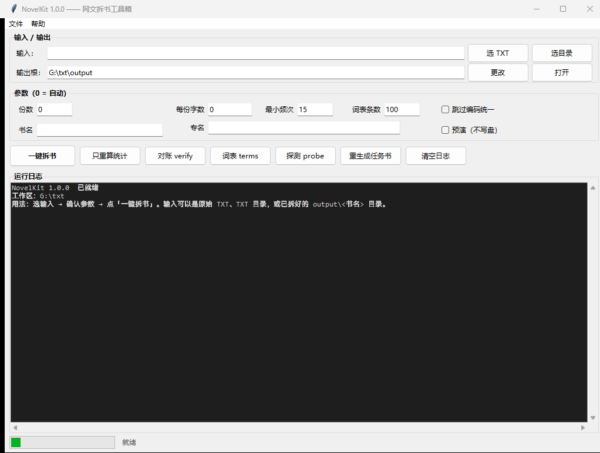

# NovelKit —— 一个 EXE 的拆书工具箱

> 把 `tools/novel_split` + `tools/chai/chai_stats` 的能力打包成**单个 Windows 可执行文件**：
> 拆书（probe → encode → analyze → split）、机读统计、对账、词表、精读任务书，双击即用，**不需要装 Python**。

- 成品：`tools/novelkit/dist/NovelKit.exe`（约 **11 MB**，单文件、独立运行）
- 界面：`screenshot.png`
- 源码：`novelkit.py`（入口）· `nv_core.py`（流水线）· `nv_gui.py`（tkinter 界面）



---

## 一、为什么要有它

原来的流程是「PowerShell 编排 + 两个 Python 脚本」：

```
chai.ps1 ─┬─> novel_split.py  probe / encode / analyze / split
          └─> chai_stats.py   stats / verify / terms
```

这套东西要求目标机器有 Python 3.10+ 和 PowerShell。NovelKit 把它们**编译进一个 EXE**，
并且把编排逻辑从 PowerShell 移植成了 Python：

| | 原脚本 | NovelKit.exe |
|---|---|---|
| 运行前提 | Python + PowerShell | 无（运行时自带） |
| 入口 | 命令行 / 手改参数 | 双击出界面，也能命令行 |
| 编排逻辑 | `chai.ps1` | `nv_core.py`（同步骤、同参数、同产物） |
| 跨机器 | 要拷整个 `tools/` | 拷一个 exe 即可 |
| 可改性 | 改脚本 | 改源码后重新打包（`build.ps1`） |

**产物完全一致**：目录结构、文件名、指标口径、`manifest.json` 校验方式都与 `chai.ps1` 相同，
两个入口可以混用（EXE 拆到一半，脚本接着跑统计也没问题）。

---

## 二、三种用法

### 1. 双击（推荐）

双击 `NovelKit.exe` → 图形界面：

1. 「选 TXT」挑原始小说，或「选目录」挑 TXT 所在目录 / 已拆好的 `output\<书名>`；
2. 输出根默认是工作区的 `output\`（找不到工作区时用 exe 同级的 `output\`）；
3. 点「一键拆书」。

界面上的按钮：

| 按钮 | 作用 |
|---|---|
| **一键拆书** | probe →（encode）→ analyze → split → stats → verify → 精读任务书 |
| 只重算统计 | 对已拆好的目录只跑 stats（不重新切分） |
| 对账 verify | 用 `正文 + 标题行 + 前置信息 == 索引净字数` 校验零丢失 |
| 词表 terms | 输出候选专名/术语（频次、首现章），可配合「专名」输入强制收录 |
| 探测 probe | 只看编码 / BOM / 换行，不写盘 |
| 重生成任务书 | 只重写 `精读任务书.md` |
| 清空日志 / 打开 | 清空日志；在资源管理器里打开输出目录 |

参数说明：`份数` 与 `每份字数` 二选一（都填 0 = 每份约 10 万字自动），`最小频次` 控制词表噪音，
`专名` 是人工确认的名字（逗号分隔）；「跳过编码统一」「预演（不写盘）」是开关。

### 2. 命令行

```powershell
NovelKit.exe                                              # 打开图形界面
NovelKit.exe chai novels\某本书.txt                        # 一键拆书
NovelKit.exe chai output\某本书 --tasks-only               # 只补任务书
NovelKit.exe chai novels --parts 30 --terms "亚伦,苏伦"     # 批量 / 指定份数 / 强制专名
NovelKit.exe stats  output\某本书                          # 只重算统计
NovelKit.exe verify output\某本书                          # 对账
NovelKit.exe terms  output\某本书 --top-n 200              # 词表
NovelKit.exe probe  novels                                 # 看编码
NovelKit.exe split  novels --out output --parts 30         # 透传底层 novel_split
NovelKit.exe where                                         # 打印工作区 / 默认输出
NovelKit.exe --version
```

`probe / encode / analyze / split / all` 与 `stats / verify / terms` 是**原样透传**给
`novel_split.py` / `chai_stats.py` 的，参数与文档完全一致（见各自 README）。

### 3. 放到任意目录

EXE 会向上查找「含 `tools\novel_split` 或 `novels` 的目录」当作工作区，默认输出到 `<工作区>\output`。
找不到就退回到 **exe 同级的 `output\`**，此时用界面里的「输出根」或 `--out` 指定即可。

---

## 三、它做了什么（五阶段）

```
原始 TXT
  ├─① probe    探测编码 / 换行 / BOM（不写盘）
  ├─② encode   无损统一到 UTF-8 + CRLF（就地改写，留 .bak；已符合则跳过）
  ├─③ analyze  分析卷 / 章结构
  ├─④ split    规范化 + 排序 + 切分（有卷按卷，无卷每份约 10 万字）
  └─⑤ stats    机读统计 → chapters.csv / terms.csv / stats.json / stats_摘要.md
       └─ verify 对账 + 精读任务书.md
```

产物布局与 `chai.ps1` 完全一致：

```
output\<书名>\           分卷正文 + 00_目录索引.md + 01_章节清单.tsv + manifest.json
output\<书名>_分析\      stats_摘要.md / stats.json / chapters.csv / terms.csv / 精读任务书.md
```

指标口径（净字数、章长、钩型、术语）沿用 `tools/chai/README.md` 第五节，报告可直接跨入口对比。

---

## 四、自己构建

```powershell
.\tools\novelkit\build.ps1
```

流程：

1. 检查 `import PyInstaller`；没有就运行 `bootstrap_pyinstaller.py`，
   从 PyPI 取 wheel 解包到 `_pylib\`（**故意不走 `pip install --target`**：
   受限环境下 pip 往临时目录写 `.whl.metadata` 会被拒，直接取 wheel 更稳）。
2. `py -3 -m PyInstaller --onefile --console --name NovelKit`，
   把 `tools\novel_split`、`tools\chai` 加入搜索路径并显式 `--hidden-import`。
3. 冒烟测试 `--version` / `where`，输出 `dist\NovelKit.exe`。

依赖（仅构建期需要，运行期零依赖）：PyInstaller 6.22、altgraph、packaging、pefile、pywin32-ctypes、pyinstaller-hooks-contrib。

> 用 `--console` 而不是 `--windowed`：这样命令行模式才有 stdout；
> 图形模式启动后用 `ShowWindow(SW_HIDE)` 把控制台藏掉。

---

## 五、实现要点（踩过的坑）

| 坑 | 现象 | 处理 |
|---|---|---|
| **日志递归** | CLI 里 `log=print`，而 `print` 写到的 `sys.stdout` 正被重定向回 `log` → 无限递归，报 `Stack overflow` | `_run_module()` 检测到 `log is print` 时改写到「重定向前」的原始 stdout |
| **控制台编码** | 打包后中文乱码，`✓` 直接抛 `UnicodeEncodeError: 'gbk' codec` | 入口 `_force_utf8_io()`：`SetConsoleOutputCP(65001)` + `sys.stdout.reconfigure('utf-8')` |
| **单文件解包** | onefile 每次启动要把依赖解到 `%TEMP%\_MEIxxxx`，该目录 DACL 只授权当前用户 | 正常桌面无影响；受限/沙箱环境下会 `Permission denied` —— 需要受限环境时改用 `--onedir` 构建 |
| **隐式导入** | `novel_split` / `chai_stats` 不在包内，打包后 `ModuleNotFoundError` | 构建时 `--paths` + `--hidden-import`；源码运行时由 `_ensure_tool_paths()` 补 `sys.path` |

---

## 六、已知限制

- **启动约 1 秒**：onefile 要先解包到临时目录，杀软扫描会拖慢首次启动。
- **SmartScreen**：未签名 EXE，首次运行 Windows 可能提示「未知发布者」，选「仍要运行」。
- **只处理 TXT**：EPUB/AZW3 需先转 TXT（与原工具一致）。
- **无「停止」按钮**：长任务在后台线程跑，关窗口即退出进程；需要中断就关窗口。
- **不替代脚本**：要改流程，改 `nv_core.py`（或 `chai.ps1`）后重新打包；EXE 只是分发形态。
- **GUI 与 CLI 同源**：界面不做任何独有逻辑，全部走 `nv_core.py`，所以两边结果必然一致。
